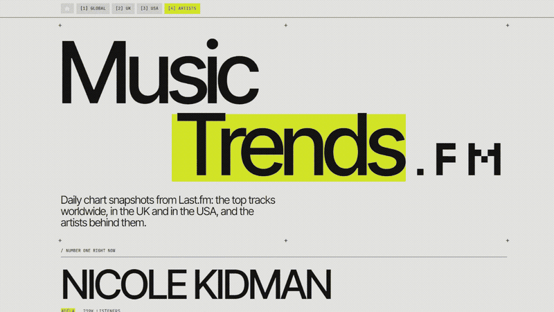
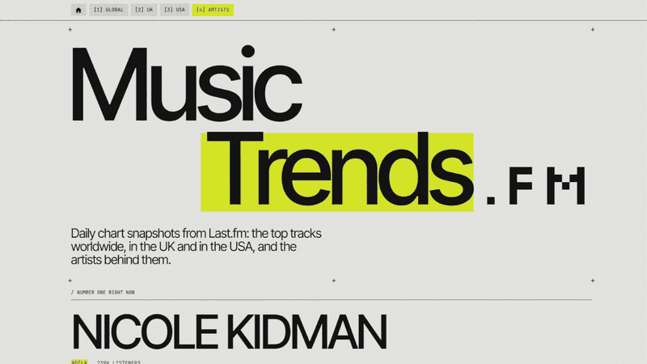

# Music Trends

A small Python project that collects daily music charts into a SQLite database and turns them into an interactive web page.

  

  

## What it does

- Collects the top 50 tracks each day from Last.fm for three charts: global, UK and USA
- Stores them in a SQLite database
- Looks up artist photos on Deezer, using exact name matching, and saves each photo once so it isn't looked up again
- Builds a single web page from the database, with an animated image effect over black-and-white artist photos

## How it works

1. `collect.py` downloads the charts and photos and saves them in `charts.db`
2. `build.py` reads the database and writes `site/index.html`
3. `style.css` and `app.js` are the page's styling and animation
4. `run.bat` runs both steps and opens the page (Windows only)

Only Python's built-in libraries are used, so there is nothing to install.

## Running it

1. Install Python 3
2. Get a free API key from https://www.last.fm/api
3. Double-click `run.bat`. The first time, it asks for your key and saves it in a local `.env` file

The `.env` file, the database and the downloaded artist photos are not part of this repository.